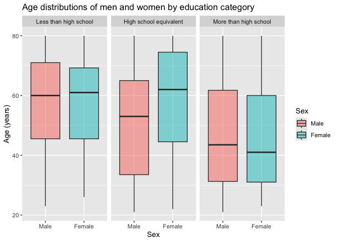
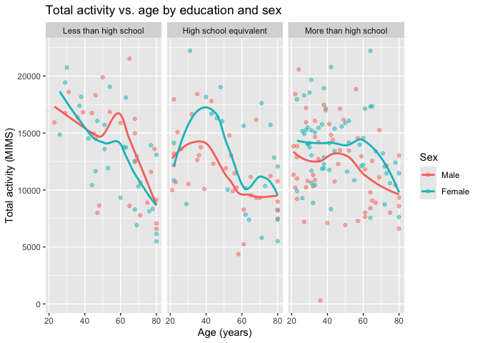
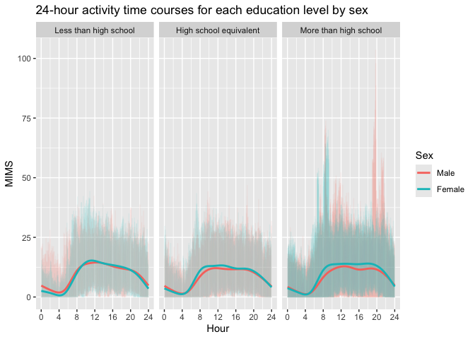
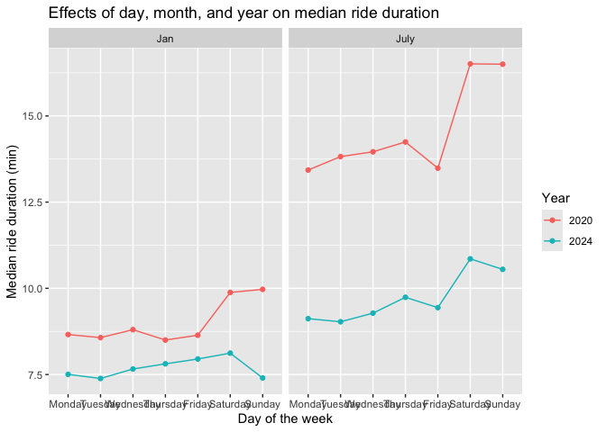
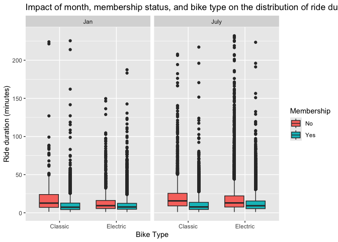

P8105 HW3 - Sophie Gakis (sig2127)
================
2026-10-12

``` r
library(tidyverse)
```

    ## ── Attaching core tidyverse packages ──────────────────────── tidyverse 2.0.0 ──
    ## ✔ dplyr     1.2.1     ✔ readr     2.2.0
    ## ✔ forcats   1.0.1     ✔ stringr   1.6.0
    ## ✔ ggplot2   4.0.3     ✔ tibble    3.3.1
    ## ✔ lubridate 1.9.5     ✔ tidyr     1.3.2
    ## ✔ purrr     1.2.2     
    ## ── Conflicts ────────────────────────────────────────── tidyverse_conflicts() ──
    ## ✖ dplyr::filter() masks stats::filter()
    ## ✖ dplyr::lag()    masks stats::lag()
    ## ℹ Use the conflicted package (<http://conflicted.r-lib.org/>) to force all conflicts to become errors

# Problem 2

## Loading, tidying, merging, and organizing the data sets

``` r
demo_df = 
  read_csv(
    file = "Data/nhanes_covar.csv",
    na = c(".", "NA", "")) |>
    janitor::clean_names() |>
    rename(
      SEQN = x1, 
      Sex = x1_male, 
      Age = x3, 
      BMI = x4, 
      Education = x1_less_than_high_school
    )|>
    mutate(
    Sex = case_match(
      Sex,  
      "1" ~ "Male", 
      "2" ~ "Female"
    ),
    Education = case_match(
      Education, 
      "1" ~ "Less than high school", 
      "2" ~ "High school equivalent", 
      "3" ~ "More than high school"
    ), 
    Age = as.numeric(Age), 
    BMI = as.numeric(BMI), 
    SEQN = as.numeric(SEQN), 
    Sex = factor(
      Sex, 
      levels = c("Male", "Female")
      ),
    Education = factor(
      Education, 
      levels = c("Less than high school", "High school equivalent", "More than high school"),
      ordered = TRUE)
    ) |>
    filter(
      Age >= 21, 
    ) |>
  drop_na()
```

    ## New names:
    ## Rows: 254 Columns: 5
    ## ── Column specification
    ## ──────────────────────────────────────────────────────── Delimiter: "," chr
    ## (5): ...1, 1 = male, ...3, ...4, 1 = Less than high school
    ## ℹ Use `spec()` to retrieve the full column specification for this data. ℹ
    ## Specify the column types or set `show_col_types = FALSE` to quiet this message.
    ## • `` -> `...1`
    ## • `` -> `...3`
    ## • `` -> `...4`

    ## Warning: There were 4 warnings in `mutate()`.
    ## The first warning was:
    ## ℹ In argument: `Sex = case_match(Sex, "1" ~ "Male", "2" ~ "Female")`.
    ## Caused by warning:
    ## ! `case_match()` was deprecated in dplyr 1.2.0.
    ## ℹ Please use `recode_values()` instead.
    ## ℹ Run `dplyr::last_dplyr_warnings()` to see the 3 remaining warnings.

``` r
accel_df = 
  read_csv(
    file = "Data/nhanes_accel.csv",
    na = c(".", "NA", "")) |>
    janitor::clean_names() |>
  pivot_longer(
    min1:min1440, 
    names_to = "Minute", 
    names_prefix = "min", 
    values_to = "MIMS"
  ) |> 
  rename(
    SEQN = seqn
  ) |> 
  mutate(
    Minute = as.integer(Minute)
  )
```

    ## Rows: 250 Columns: 1441
    ## ── Column specification ────────────────────────────────────────────────────────
    ## Delimiter: ","
    ## dbl (1441): SEQN, min1, min2, min3, min4, min5, min6, min7, min8, min9, min1...
    ## 
    ## ℹ Use `spec()` to retrieve the full column specification for this data.
    ## ℹ Specify the column types or set `show_col_types = FALSE` to quiet this message.

``` r
combo_df =
  inner_join(demo_df, accel_df, by = "SEQN")
```

## Table for the number of males and females in each education category

``` r
demo_df |>
  group_by(Education, Sex) |>
  summarize(count = n()) |> 
  knitr::kable(
    caption = "Number of males and females by education category"
  )
```

    ## `summarise()` has regrouped the output.
    ## ℹ Summaries were computed grouped by Education and Sex.
    ## ℹ Output is grouped by Education.
    ## ℹ Use `summarise(.groups = "drop_last")` to silence this message.
    ## ℹ Use `summarise(.by = c(Education, Sex))` for per-operation grouping
    ##   (`?dplyr::dplyr_by`) instead.

| Education              | Sex    | count |
|:-----------------------|:-------|------:|
| Less than high school  | Male   |    27 |
| Less than high school  | Female |    28 |
| High school equivalent | Male   |    35 |
| High school equivalent | Female |    23 |
| More than high school  | Male   |    56 |
| More than high school  | Female |    59 |

Number of males and females by education category

As seen in this table, the “less than high school” and “more than high
school” education categories are roughly equal in terms of males and
females. The “high school eqivalent” category however, has more males
compared to females.

## Visualization of the age distributions for men and women in each education category

``` r
demo_df |>
  ggplot(aes(x = Sex, y = Age, fill = Sex)) +
  geom_boxplot(alpha = 0.5) +
  facet_grid(. ~ Education) +
  labs(
    title = "Age distributions of men and women by education category",
    x = "Sex",
    y = "Age (years)"
  ) 
```

<!-- -->

As seen here, the age distributions of males and females look fairly
similar within the “Less than high school” and “More than high school”
groups. The “Less than high school” group is the oldest overall, as the
median age is around 60 in both males and females. The “High school
equivalent” group shows more difference by sex, with the median female
age at about 62 and the median male age at about 53. In this category,
the female distribution as a whole appears older than the male one. The
“More than high school” group is the youngest, with median ages in the
low 40s for both sexes.

## Creating a total activity variable for each participant

``` r
totact_df =
  combo_df |>
  group_by(SEQN, Sex, Age, BMI, Education) |>
  summarize(total_activity = sum(MIMS, na.rm = TRUE), .groups = "drop") 
```

## Plotting total activities against age

``` r
totact_df |>
  ggplot(aes(x = Age, y = total_activity, color = Sex)) +
  geom_point(alpha = 0.5) +
  geom_smooth(se = FALSE) +
  facet_grid(. ~ Education) +
  labs(
    title = "Total activity vs. age by education and sex",
    x = "Age (years)",
    y = "Total activity (MIMS)"
  )
```

    ## `geom_smooth()` using method = 'loess' and formula = 'y ~ x'

<!-- -->

As seen in this plot, total activity generally declines in all education
levels and for both sexes after age 60. In general, females tend to have
higher levels of total activity than men, with the exception of those
over 40 in the “less than high school” education group. The difference
in total activity between sexes is most apparent in the “high school
equivalent” group, where the females have a much higher level of total
activity than males up until age 60 where both groups come closer
together.

## Making a three-panel plot that shows the 24-hour activity time courses for each education level

``` r
combo_df |>
  ggplot(aes(x = Minute / 60, y = MIMS, color = Sex)) +
  geom_line(alpha = 0.07) +
  geom_smooth(se = FALSE) +
  facet_grid(. ~ Education)  +
  scale_x_continuous(
    breaks = c(0, 4, 8, 12, 16, 20, 24),
    limits = c(0, 24)
  ) + 
  labs(
    title = "24-hour activity time courses for each education level by sex",
    x = "Hour",
    y = "MIMS",
    color = "Sex"
  ) 
```

    ## `geom_smooth()` using method = 'gam' and formula = 'y ~ s(x, bs = "cs")'

<!-- -->

As seen in this plot, the 24-hour activity time courses for each
education level are relatively similar by sex within each education
group, and across each education group. The overall shape is similar
across groups, with a decline from hours 0-4 in the day which then turns
to an incline from hours 4-12 before plateauing from hours 12-20 and
then slowly declining again from hours 20-24. For the “less than high
school” group and the “high school equivalent” groups the trend lines
over the course of the day are roughly even for males and females,
though in the “more than high school” group the trend line for males is
continuously raised above that for females from hours 4 to 20.

# Problem 3

## Importing, cleaning, and tidying the data

``` r
jan20_df = 
  read_csv(
    file = "Data/Jan 2020 Citi.csv") |>
    janitor::clean_names() |>
    rename(
      `Ride ID` = ride_id, 
      `Bike Type` = rideable_type, 
      Day = weekdays, 
      `Duration (Minutes)` = duration, 
      `Start Station` = start_station_name, 
      `End Station` = end_station_name, 
      Membership = member_casual
    ) |>
    mutate(
    `Bike Type` = case_match(
      `Bike Type`,  
      "classic_bike" ~ "Classic", 
      "electric_bike" ~ "Electric"
    ),
    Membership = case_match(
      Membership,  
      "member" ~ "Yes", 
      "casual" ~ "No"
    ), 
    `Duration (Minutes)` = round(as.numeric(`Duration (Minutes)`), digits = 2), 
    `Set Name` = "Jan 2020"
    )  
```

    ## Rows: 12420 Columns: 7
    ## ── Column specification ────────────────────────────────────────────────────────
    ## Delimiter: ","
    ## chr (6): ride_id, rideable_type, weekdays, start_station_name, end_station_n...
    ## dbl (1): duration
    ## 
    ## ℹ Use `spec()` to retrieve the full column specification for this data.
    ## ℹ Specify the column types or set `show_col_types = FALSE` to quiet this message.

``` r
jul20_df = 
  read_csv(
    file = "Data/July 2020 Citi.csv") |>
    janitor::clean_names() |>
    rename(
      `Ride ID` = ride_id, 
      `Bike Type` = rideable_type, 
      Day = weekdays, 
      `Duration (Minutes)` = duration, 
      `Start Station` = start_station_name, 
      `End Station` = end_station_name, 
      Membership = member_casual
    ) |>
    mutate(
    `Bike Type` = case_match(
      `Bike Type`,  
      "classic_bike" ~ "Classic", 
      "electric_bike" ~ "Electric"
    ),
    Membership = case_match(
      Membership,  
      "member" ~ "Yes", 
      "casual" ~ "No"
    ), 
    `Duration (Minutes)` = round(as.numeric(`Duration (Minutes)`), digits = 2), 
    `Set Name` = "July 2020"
    )
```

    ## Rows: 21048 Columns: 7
    ## ── Column specification ────────────────────────────────────────────────────────
    ## Delimiter: ","
    ## chr (6): ride_id, rideable_type, weekdays, start_station_name, end_station_n...
    ## dbl (1): duration
    ## 
    ## ℹ Use `spec()` to retrieve the full column specification for this data.
    ## ℹ Specify the column types or set `show_col_types = FALSE` to quiet this message.

``` r
jan24_df = 
  read_csv(
    file = "Data/Jan 2024 Citi.csv") |>
    janitor::clean_names() |>
    rename(
      `Ride ID` = ride_id, 
      `Bike Type` = rideable_type, 
      Day = weekdays, 
      `Duration (Minutes)` = duration, 
      `Start Station` = start_station_name, 
      `End Station` = end_station_name, 
      Membership = member_casual
    ) |>
    mutate(
    `Bike Type` = case_match(
      `Bike Type`,  
      "classic_bike" ~ "Classic", 
      "electric_bike" ~ "Electric"
    ),
    Membership = case_match(
      Membership,  
      "member" ~ "Yes", 
      "casual" ~ "No"
    ), 
    `Duration (Minutes)` = round(as.numeric(`Duration (Minutes)`), digits = 2), 
    `Set Name` = "Jan 2024"
    )
```

    ## Rows: 18861 Columns: 7
    ## ── Column specification ────────────────────────────────────────────────────────
    ## Delimiter: ","
    ## chr (6): ride_id, rideable_type, weekdays, start_station_name, end_station_n...
    ## dbl (1): duration
    ## 
    ## ℹ Use `spec()` to retrieve the full column specification for this data.
    ## ℹ Specify the column types or set `show_col_types = FALSE` to quiet this message.

``` r
jul24_df = 
  read_csv(
    file = "Data/July 2024 Citi.csv") |>
    janitor::clean_names() |>
    rename(
      `Ride ID` = ride_id, 
      `Bike Type` = rideable_type, 
      Day = weekdays, 
      `Duration (Minutes)` = duration, 
      `Start Station` = start_station_name, 
      `End Station` = end_station_name, 
      Membership = member_casual
    ) |>
    mutate(
    `Bike Type` = case_match(
      `Bike Type`,  
      "classic_bike" ~ "Classic", 
      "electric_bike" ~ "Electric"
    ),
    Membership = case_match(
      Membership,  
      "member" ~ "Yes", 
      "casual" ~ "No"
    ), 
    `Duration (Minutes)` = round(as.numeric(`Duration (Minutes)`), digits = 2), 
    `Set Name` = "July 2024"
    )
```

    ## Rows: 47156 Columns: 7
    ## ── Column specification ────────────────────────────────────────────────────────
    ## Delimiter: ","
    ## chr (6): ride_id, rideable_type, weekdays, start_station_name, end_station_n...
    ## dbl (1): duration
    ## 
    ## ℹ Use `spec()` to retrieve the full column specification for this data.
    ## ℹ Specify the column types or set `show_col_types = FALSE` to quiet this message.

``` r
combined_df = bind_rows(jan20_df, jul20_df, jan24_df, jul24_df)
```

## Describing the resulting dataset

The resulting merged dataset is now a combination of all 4 original data
sets (Jan 2020, July 2020, Jan 2024, and July 2024). The dataset
contains 8 columns of data for variables Ride ID, Bike Type (electric vs
classic), Day of ride, Ride duration in minutes, Start and End station
names, if the person had a membership or not, and what original dataset
the entry was from. There are 99,485 entries in the combined set.

## Producing a table to look at membership vs non-membership rides in each year month combination

``` r
combined_df |>
  group_by(`Set Name`, Membership) |>
  summarize(count = n()) |> 
  knitr::kable(
    caption = "Membership vs Non-Membership rides in each year month combination"
  )
```

    ## `summarise()` has regrouped the output.
    ## ℹ Summaries were computed grouped by Set Name and Membership.
    ## ℹ Output is grouped by Set Name.
    ## ℹ Use `summarise(.groups = "drop_last")` to silence this message.
    ## ℹ Use `summarise(.by = c(Set Name, Membership))` for per-operation grouping
    ##   (`?dplyr::dplyr_by`) instead.

| Set Name  | Membership | count |
|:----------|:-----------|------:|
| Jan 2020  | No         |   984 |
| Jan 2020  | Yes        | 11436 |
| Jan 2024  | No         |  2108 |
| Jan 2024  | Yes        | 16753 |
| July 2020 | No         |  5637 |
| July 2020 | Yes        | 15411 |
| July 2024 | No         | 10894 |
| July 2024 | Yes        | 36262 |

Membership vs Non-Membership rides in each year month combination

Based on this table, it appears as though are more rides overall in the
summer months (July) as opposed to the winter months (January). Rides
also generally increased in both the membership and non-membership
categories, in both January and July, from 2020 to 2024. In addition,
membership rides made up the majority of rides in each combination of
year and month.

## Producing a table to look at the most popular starting stations for July 2024

``` r
jul24_df |>
  group_by(`Start Station`) |>
  summarize(count = n()) |>
  arrange(desc(count)) |>
  slice_head(n = 5) |>
  knitr::kable(
    caption = "5 most popular starting stations for July 2024"
  )
```

| Start Station            | count |
|:-------------------------|------:|
| Pier 61 at Chelsea Piers |   163 |
| University Pl & E 14 St  |   155 |
| W 21 St & 6 Ave          |   152 |
| West St & Chambers St    |   150 |
| W 31 St & 7 Ave          |   146 |

5 most popular starting stations for July 2024

## Making a plot to investigate the effects of day of the week, month, and year on median ride duration

``` r
combined_df |>
  separate(`Set Name`, into = c("Month", "Year")) |>
  mutate(
    Day = factor(
      Day, 
      levels = c("Monday", "Tuesday", "Wednesday", "Thursday", "Friday", "Saturday", "Sunday")
    ),
    Month = factor(
      Month, 
      levels = c("Jan", "July"))
  ) |>
  group_by(Year, Month, Day) |>
  summarize(
    median_ridetime = median(`Duration (Minutes)`, na.rm = TRUE)
  ) |>
  ggplot(aes(x = Day, y = median_ridetime, color = Year, group = Year)) +
  geom_line() +
  geom_point() +
  facet_grid(. ~ Month) +
  labs(
    title = "Effects of day, month, and year on median ride duration",
    x = "Day of the week",
    y = "Median ride duration (min)",
    color = "Year"
  ) 
```

    ## `summarise()` has regrouped the output.
    ## ℹ Summaries were computed grouped by Year, Month, and Day.
    ## ℹ Output is grouped by Year and Month.
    ## ℹ Use `summarise(.groups = "drop_last")` to silence this message.
    ## ℹ Use `summarise(.by = c(Year, Month, Day))` for per-operation grouping
    ##   (`?dplyr::dplyr_by`) instead.

<!-- -->

This plot shows the effects of day, month, and year on median ride
duration. As seen, the median ride duration was the highest overall in
July 2020. The median ride duration, generally, seems to increase during
the weekend days (Saturday and Sunday), as compared to the week days
(Monday-Friday). As exception to this was Sundays in January 2024, which
is among the lowest median ride duration out of all days of the week. In
addition, the median ride duration was greater in 2020 for all days of
the week in both January and July.

## Making a plot to investigate the impact of month, membership status, and bike type on the distribution of ride duration

``` r
combined_df |>
  filter(`Set Name` %in% c("Jan 2024", "July 2024")) |>
  separate(`Set Name`, into = c("Month", "Year")) |>
  mutate(
    Month = factor(
      Month, 
      levels = c("Jan", "July"))
  ) |>
  ggplot(aes(x = `Bike Type`, y = `Duration (Minutes)`, fill = Membership)) +
  geom_boxplot() +
  facet_grid(. ~ Month) +
  labs(
    title = "Impact of month, membership status, and bike type on the distribution of ride duration in 2024",
    x = "Bike Type",
    y = "Ride duration (minutes)"
  ) 
```

<!-- -->

Based on these box plots, generally, casual riders without a membership
take longer rides than those with membership do. The difference between
membership and non-membership ride length seems to be the largest on the
classic bikes. Classic bikes are also used for slightly longer duration
rides than electric bikes, which is most apparent among non-membership
or casual riders. Also, July rides appear to be longer than January
rides in every group. In addition, all of the box plots are right-skewed
with median values near the lower end of each box. This indicates that a
majority of rides are on the shorter side, with a smaller amount
reaching a duration of a few hours.
